  <picture>
    <source media="(prefers-color-scheme: dark)" srcset="assets/banner-dark.svg">
    <source media="(prefers-color-scheme: light)" srcset="assets/banner-light.svg">
    
  </picture>

# itboy365

**河北保定 · 独立开发者 / Baoding, Hebei · Independent Developer**

前端可视化 · 量化工具 · 数字身份
Frontend Visualization · Quant Toolchain · Digital Identity

用代码把想法一个个落地。 / Build ideas into reality, line by line.

---

## 作品 / Projects

 

<table>
<tr>
<td width="50%" valign="top">

### ⏳ life-timer

**人生仪表盘 / Life Dashboard**
精确年龄、已活时间、人生进度、生日倒计时、生命周数与生命日历。纯前端，零依赖，开箱即用。
Precise age, elapsed time, life progress, birthday countdown, weeks and calendar. Pure frontend, zero dependency.

[在线访问 / Live Demo](https://itboy365.github.io/life-timer/) · [仓库 / Repository](https://github.com/itboy365/life-timer)

</td>
<td width="50%" valign="top">

### 🎆 yanhua

**交互式烟花模拟器 / Interactive Fireworks**
基于 Canvas 的粒子爆炸、重力下落、拖尾残影。纯前端零依赖。
Canvas-based particle explosion, gravity, and trails. Pure frontend, zero dependency.

[在线访问 / Live Demo](https://itboy365.github.io/yanhua/) · [仓库 / Repository](https://github.com/itboy365/yanhua)

</td>
</tr>
<tr>
<td width="50%" valign="top">

### 🌐 itboy

**个人主页站点 / Personal Homepage**
作品聚合与日常记录。
Portfolio aggregation and daily notes.

[在线访问 / Live Demo](https://itboy.top) · [仓库 / Repository](https://github.com/itboy365/itboy)

</td>
<td width="50%" valign="top">

### 💳 jiaquan

**数字名片 / Digital Business Card**
一张安静的互联网名片，独立开发者线上身份。
A quiet internet card for independent developer identity.

[在线访问 / Live Demo](https://jiaquan.itboy.top) · [仓库 / Repository](https://github.com/itboy365/jiaquan)

</td>
</tr>
<tr>
<td width="50%" valign="top">

### 🚪 itboy-portal

**门户静态产物 / Static Portal**
每日自动更新，聚合速览、热搜、金价等公开数据。
Daily auto-updated portal aggregating overview, trends, gold prices and public data.

[在线访问 / Live Demo](https://itboy365.github.io/itboy-portal/) · [仓库 / Repository](https://github.com/itboy365/itboy-portal)

</td>
<td width="50%" valign="top">

### 📈 ashare-quant-workbench

**A 股量化工作台 / A-Share Quant Workbench**
自托管 K 线大屏，Docker 一键部署。8 大策略共振、安检门风控、AI 研报、MCP 集成、中英文双语文档。
Self-hosted K-line dashboard, Docker one-click deploy. 8-strategy resonance, risk gate, AI reports, MCP integration, bilingual docs.

[仓库 / Repository](https://github.com/itboy365/ashare-quant-workbench)

</td>
</tr>
</table>

 

---

## 技术栈 / Stack

从前端可视化到自托管全链路。 / From frontend visualization to self-hosted full stack.

---

## 原则 / Principles

**做有用的东西，不做花架子。 / Build useful things, no vanity.**

结构清晰 · 依赖可控 · 文档可读
Clear structure · Controlled dependencies · Readable docs

零依赖优先 · 自托管优先 · 开箱即用
Zero-dependency first · Self-hosted first · Ready to use

---

## 交流 / Contact

有想法或建议，欢迎通过 GitHub Issue 交流。
Ideas or suggestions? Reach out via GitHub Issue.

[发起 Issue / Open Issue](https://github.com/itboy365/itboy365/issues)

  

